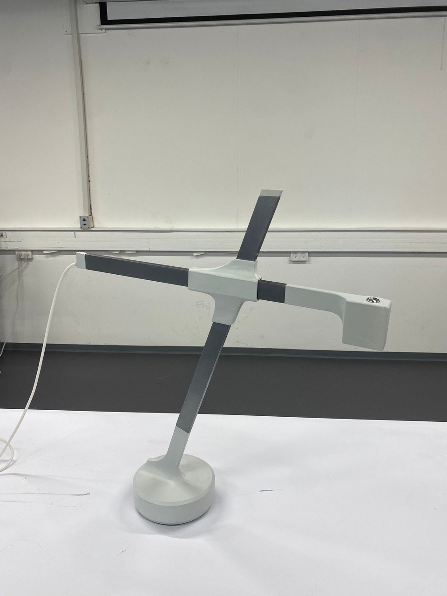

# Noam Fink, portfolio

A plain static site: HTML and CSS generated by one small script (`build.mjs`), no framework.

## What's where

| Path | What it is | Edit it to… |
|---|---|---|
| `site.json` | Your name, email, LinkedIn, hero line, About text, facts | change contact details and About |
| `projects/NN-name.md` | One file per project. The `NN` number sets the order on the home page | change titles, summaries, text, captions, image order |
| `sketches/<slug>.svg` | Line sketch shown on each home page tile | swap in a new sketch |
| `images/<slug>/` | Full-resolution originals downloaded from Adobe Portfolio | replace or add photos |
| `static/styles.css` | All styling, colours (top of file) and dark mode | tweak design |
| `content/<slug>.json` | Raw text and image list extracted from the old site (reference only, not used by the build) | nothing |
| `dist/` | The built site that gets deployed (generated, don't edit) | nothing |

### Writing a project page

Each project file starts with a short header, then Markdown:

```markdown
---
title: Lamp
slug: lamp
summary: One line that appears under the title and in link previews.
tint: stone          # tile colour: sage, stone, mist or clay
cover: images/lamp/05.jpg   # image used for the LinkedIn/email preview
credits: Designed with …    # optional
award: …                    # optional, shown in green
---

## Problem
Text…


```

- Leave the quoted caption out if an image needs none.
- `<!-- TODO: … -->` notes are invisible on the site; the build prints them as a checklist.
- An `.mp4` in an image line becomes a video player (see `09-juicer.md`).

## Build and preview

You need Node.js 20 or newer (https://nodejs.org).

```bash
npm install
npm run build
node serve.mjs
```

Then open http://localhost:4321. The build prints anything still missing (placeholders, low-res images, TODO notes).

## Publishing (GitHub Pages)

The site lives at **https://noamfink.github.io**, from the repository
https://github.com/noamfink/noamfink.github.io.

Every push to the `main` branch rebuilds and republishes the site automatically
(`.github/workflows/deploy.yml`). It takes about a minute; progress shows under the
repository's **Actions** tab.

The easiest way to edit without the command line is **GitHub Desktop** (desktop.github.com):
clone the repository, edit files, then **Commit** and **Push**. You can also edit a
Markdown file directly on github.com with the pencil icon.

`netlify.toml` is left over from the first host and is ignored by GitHub.

## Connecting a custom domain (for example noamfink.com)

1. Buy the domain (Namecheap, Cloudflare, Porkbun…).
2. At your registrar, add DNS records:
   - four `A` records for `@` → `185.199.108.153`, `185.199.109.153`, `185.199.110.153`, `185.199.111.153`
   - a `CNAME` for `www` → `noamfink.github.io`
3. On GitHub: repository → **Settings → Pages → Custom domain**, type `noamfink.com`, **Save**.
4. Wait for DNS (minutes to a few hours), then tick **Enforce HTTPS** on the same page.
5. Update `"url"` in `site.json` and `static/robots.txt` to `https://noamfink.com` and push.

## Resume

Save your resume as `resume.pdf` in this folder (next to `site.json`) and rebuild; the build copies it to `/resume.pdf`.
